# Цифровой термометр на Atmega328 с датчиком DS18B20 / SHT40 с выводом на LCD TFT экран

> Описание проекта: назначение, железо, распиновка, схема подключения, прошивка, корпус, структура репозитория.

<!-- toc -->

**Оглавление**

- [Принцип работы и алгоритмы](#принцип-работы-и-алгоритмы)
- [1. Назначение](#1-назначение)
- [2. Аппаратная платформа](#2-аппаратная-платформа)
  - [Микроконтроллер](#микроконтроллер)
  - [Экраны (выбор при сборке)](#экраны-выбор-при-сборке)
  - [Датчики (определяются автоматически)](#датчики-определяются-автоматически)
- [3. Распиновка](#3-распиновка)
- [4. Схема подключения](#4-схема-подключения)
  - [Плата кнопок и питания](#плата-кнопок-и-питания)
- [5. Как работает прошивка](#5-как-работает-прошивка)
- [6. Экран и управление](#6-экран-и-управление)
  - [Главный экран](#главный-экран)
  - [Включение и ошибки датчика](#включение-и-ошибки-датчика)
  - [Тенденция](#тенденция)
  - [График за сутки](#график-за-сутки)
  - [Кнопки](#кнопки)
  - [Настройки (EEPROM)](#настройки-eeprom)
- [7. Корпус](#7-корпус)
- [8. Структура репозитория](#8-структура-репозитория)
  - [Сборка и прошивка](#сборка-и-прошивка)
  - [Новая плата: загрузчик, ChipInfo, прошивка](#новая-плата-загрузчик-chipinfo-прошивка)
  - [Проверка микроконтроллера (ChipInfo)](#проверка-микроконтроллера-chipinfo)
- [9. Лицензия](#9-лицензия)

<!-- /toc -->

---

## Принцип работы и алгоритмы

Датчик на улице опрашивается с заданным периодом. Каждое удачное измерение с поправкой из настроек показывается на
экране и попадает в три независимых кольцевых буфера: для стрелки тенденции, графика за сутки и мин / макс. История
хранится в ОЗУ, настройки - в EEPROM.

```text
датчик -> измерение + поправка -> экран (крупные цифры)
                                -> точки по 2 мин  -> стрелка тенденции (до 3 ч)
                                -> точки по 10 мин -> график за сутки
                                -> мин / макс каждого часа -> мин / макс на экране (до 24 ч)
```

**Главный цикл.** Без блокирующих задержек: сброс сторожевого таймера (1 с), шаг опроса датчика, закрытие истёкших
интервалов истории, перерисовка при новых данных, обработка кнопок. Зависание перезапускает устройство.

**Включение.** Настройки из EEPROM (ошибка версии, контрольной суммы или диапазона - значения по умолчанию) -> экран
(подсветка загорается, когда заставка уже нарисована) -> поиск датчика: сначала SHT40, не ответил - DS18B20; повторно
датчик не ищется, только при следующем включении -> заставка 3 с или до нажатия кнопки -> главный экран.

**Опрос датчика.** Раз в период из настроек (по умолчанию 10 с) запускается измерение; ожидание результата (DS18B20 -
до 750 мс) не останавливает программу. Неудачное чтение повторяется до 10 раз через 100 мс. Все повторы неудачны -
измерение пропало: на экране остаётся последняя температура и надпись «ошибка датчика», опрос продолжается с обычным
периодом, первое удачное измерение надпись убирает.

**Стрелка тенденции.**

1. Измерения усредняются за 2 мин, это одна точка; хранится 90 точек (3 ч). Интервал без измерений - пустая точка, в
   расчёт она не идёт.
2. Через точки выбранного периода (по умолчанию 60 мин - 30 точек) проводится прямая по методу наименьших квадратов.
3. Наклон прямой, умноженный на число точек периода, - изменение температуры за период.
4. Изменение не меньше порога (по умолчанию 0.50 °C) - стрелка вверх, не больше минус порога - вниз, иначе стрелки нет.
5. Пока не накопилась половина периода, стрелки нет.

Прямая, а не разность «сейчас минус период назад», нужна, чтобы порыв ветра или солнечный блик не включали стрелку.
Обратная сторона: при смене хода стрелка какое-то время показывает прежнее направление.

**Мин / макс.** Отдельно для каждого часа запоминаются наименьшее и наибольшее измерение, 24 часа. Показывается итог за
выбранный период (по умолчанию 12 ч): последние полные часы и текущий час. Учитывается каждое измерение, а не
усреднённое значение.

**График за сутки.** Измерения усредняются за 10 мин, это одна точка; хранится 144 точки (24 ч). Первая точка - через
10 мин после включения. Масштаб по температуре - по наименьшему и наибольшему значению на графике.

**Прогрев SHT40** (опция). При влажности от 95 % и температуре ниже 60 °C, не чаще раза в 5 мин, - импульс встроенного
нагревателя на 1 с. Измерение с нагревом и следующие 2 мин не используются: на экране и в истории остаётся последнее
честное значение.

**Экран.** Перерисовываются только изменившиеся части: у крупных цифр - отдельные сегменты, мин / макс, влажность и
стрелка - только при смене значения, поэтому экран не мерцает.
Разметка считается от размеров экрана: альбомная или книжная получается из настройки «Поворот».

**Кнопки.** Антидребезг 30 мс; нажатие от 1 с - долгое, событие приходит сразу при удержании. Из настроек и графика
через 30 с без нажатий - возврат на главный экран, несохранённая правка отменяется.

Подробно: прошивка - [§5](#5-как-работает-прошивка), экраны и настройки - [§6](#6-экран-и-управление).

---

## 1. Назначение

<table align="right">
<tr><td>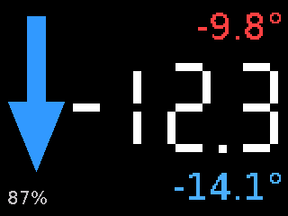<br>Главный экран (2.4", 320x240)</td></tr>
<tr><td>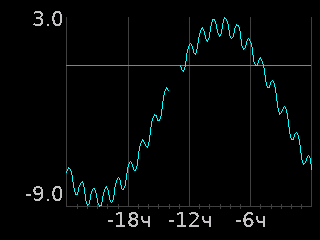<br>График за сутки</td></tr>
</table>

Уличный термометр (с SHT40 - и гигрометр): блок с экраном - в помещении, датчик - на улице на проводе.
Цветной TFT-экран, плата Arduino Pro Mini 3.3 В (запасная - клон Nano), 2 кнопки, питание от сети
220 В через встроенный блок питания HLK-3M03C. Датчик определяется при включении автоматически: сначала ищется
SHT40, если его нет - DS18B20.

## 2. Аппаратная платформа

### Микроконтроллер

| Параметр | Значение |
|---|---|
| Плата | Основная - Arduino Pro Mini 328 3.3 В / 8 МГц (аналог Baite BTE13-010, 33 x 18 мм); запасная - клон Nano 16 МГц |
| МК | ATmega328P, кварц **8 МГц** (без делителя), питание и логика **3.3 В** |
| Память | Flash 32 КБ (часть занимает бутлоадер), ОЗУ 2 КБ, EEPROM 1 КБ |
| Бутлоадер | MiniCore urboot (8 МГц - 57600), загрузка - внешний USB-UART 3.3 В. Штатный загрузчик Pro Mini (2 КБ) - перешить программатором (ISP) или грузить протоколом arduino (под программу 30 720 б) |
| Совместимость | Прошивка одна для оригинальной ATmega328P и её клонов: используются только возможности, одинаково работающие на обоих |
| Особенности | На плате - клон ATmega328P: ядро совместимо по таймингам команд, но подпись и фьюзы из программы не читаются, встроенный датчик температуры отличается (проверка - `Tests/ChipInfo`) |

### Экраны (выбор при сборке)

Описания продавцов - в [Docs/](Docs/). Экран задаётся в `platformio.ini`, секция `[display]`: разрешение `res` и
контроллер `ctrl` (недопустимое сочетание - ошибка сборки, `Scripts/display_select.py`).

| Экран | `res` | `ctrl` | Описание |
|---|---|---|---|
| 2.4" (по умолч.) | `240x320` | `ST7789` (название у продавца) или `ILI9341` (документы LCDWIKI MSP2401) | [чертёж](<Docs/TFT2.4 240x320 ST7789V.pdf>), [инструкция](<Docs/TFT2.4 240x320 ST7789V manual.pdf>), [схема](<Docs/TFT2.4 240x320 ST7789V schematic.pdf>) |
| 2.8" LCDWIKI MSP2806 / MSP2807 | `240x320` | `ILI9341` (ILI9341V) | [чертёж MSP2806](<Docs/2.8inch_SPI_Module_MSP2806_size.pdf>), [MSP2807](<Docs/2.8inch_SPI_Module_MSP2807_size.pdf>), [инструкция](<Docs/2.8inch_SPI_Module_MSP2807_User_Manual_EN.pdf>), [схема](<Docs/2.8inch_SPI_Module_MSP2807_schematic.pdf>) |
| 1.8" | `128x160` | `ST7735` | [TFT1.8 128x160 ST7735S.png](<Docs/TFT1.8 128x160 ST7735S.png>) |
| 1.77" | `128x160` | `ST7735` (порядок цветов BGR - `TFT_ST7735_TAB` в `config.h`) | [TFT1.77 128x160 ST7735S.png](<Docs/TFT1.77 128x160 ST7735S.png>) |

**2.8" (LCDWIKI MSP2806 без тачскрина / MSP2807 с ним):** ILI9341V, плата 50.0 x 86.0 мм, видимая область
43.20 x 57.60 мм, 4 отверстия Ø3.2; выводы 1-9 - как у 2.4" (VCC, GND, CS, RESET, DC, MOSI, SCK, LED, MISO), LED:
высокий - горит (ключ на модуле). Корпус (`Scripts/enclosure.py`) - пока только под 2.4".

**2.4" (LCDWIKI MSP2401 / MSP2402):** плата 42.72 x 77.18 мм, видимая область 36.72 x 48.96 мм (9.26 мм от
края без гребёнки), рамка LCD 42.72 x 60.26 мм (6.51 мм от того же края), 4 отверстия Ø3.2 (3.00 мм от длинных краёв,
3.00 и 6.92 мм от коротких); толщина без гребёнки 4.30 мм, с гребёнкой 12.68 мм, детали на обороте до 3 мм (слот SD,
контроллер тачскрина, ключ подсветки). Тачскрин (выводы `T_*`) и слот SD - не используются. **Контроллер:** в
инструкции и на чертеже - **ILI9341**, в названии модуля у продавца - ST7789V; в прошивке выбирается `ctrl` (`ST7789` /
`ILI9341`) - проверить на модуле, какой подходит (чтение ID контроллера или пробой обоих). Подсветка - через ключ Q1
на модуле, вывод LED: высокий уровень - горит (инструкция).

| Пин | 1 | 2 | 3 | 4 | 5 | 6 | 7 | 8 | 9 | 10-14 |
|---|---|---|---|---|---|---|---|---|---|---|
| Сигнал | VCC | GND | CS | RESET* | DC | SDI (MOSI) | SCK | LED | SDO (MISO) | тач: T_CLK, T_CS, T_DIN, T_DO, T_IRQ |

\* Пин 4 - RESET (инструкция LCDWIKI).

**1.8":** плата 45 x 53 мм, логика экрана (Vddio) 2.5-3.3 В. Питание: перемычка J1 разомкнута - VCC = 5 В,
замкнута - VCC = 3.3 В. Подсветка - 2 белых светодиода, 30 мА (40 мА макс.); **ключ подсветки - на модуле** (SOT-23 у R10 на
обороте; замер: BL на VCC 3.3 В - ток 1.1 мА, высокий - горит): Q1 / R6 не нужны, `TFT_BL_ACTIVE_LOW 0`. Гребёнка экрана (8 пинов),
отдельно - гребёнка SD-карты (не используется).

| Пин | 1 | 2 | 3 | 4 | 5 | 6 | 7 | 8 |
|---|---|---|---|---|---|---|---|---|
| Сигнал | RST | CS | D/C | DIN (MOSI) | CLK | VCC | BL | GND |

**1.77" (модель GMT177-01):** плата 34 x 53.7 мм, VCC 3.0-5.0 В, подсветка - 2 светодиода, 30 мА (40 мА макс.),
Vf 3.0 В. Выводы `GT_*` - микросхема шрифтов на модуле (не используется).

| Пин | 1 | 2 | 3 | 4 | 5 | 6 | 7 | 8, 9 | 10-13 | 14 |
|---|---|---|---|---|---|---|---|---|---|---|
| Сигнал | GND | VCC | SCK | SDA (MOSI) | RES | RS (DC) | CS | LEDA | GT_CS, GT_SI, GT_SO, GT_SCL | GND |

Ток контроллеров без подсветки (даташиты Sitronix, разд. 7.3, табл. 3, 25 °C, 60 кадров/с):

| Контроллер | Обычный режим | Сон (Sleep-In) | Даташит |
|---|---|---|---|
| ST7735S | 0.9 мА (макс. 2 мА) | 0.015 мА | [ST7735S_v1.1.pdf](Docs/ST7735S_v1.1.pdf) |
| ST7789V | 6.0 мА (макс. 7.5 мА); питание VDD не выше 3.3 В | 0.015 мА | [ST7789V.pdf](Docs/ST7789V.pdf) |

Модуль целиком потребляет больше: на нём есть стабилизатор (его собственный ток - от микроампер до ~5 мА,
тип стабилизатора на модулях не установлен) и, у 2.4", контроллер тачскрина.

### Датчики (определяются автоматически)

| Датчик | Интерфейс | Измеряет |
|---|---|---|
| DS18B20 | 1-Wire (подтяжка 4.7 кОм к питанию) | температура |
| SHT40 | I2C | температура, влажность |

Порядок поиска при включении: SHT40, затем DS18B20.

## 3. Распиновка

| Пин Pro Mini | Сигнал | Куда | Примечание |
|---|---|---|---|
| VCC | питание 3.3 В | HLK-3M03C +Vo | питание платы - на VCC, не на RAW (Nano - на +5V, не на VIN) |
| GND | общий | HLK -Vo, все модули | |
| D2 | 1-Wire | DS18B20 DQ | подтяжка 4.7 кОм к 3.3 В |
| D3 | подсветка (ШИМ) | база Q1 или LED/BL модуля | ШИМ таймера 2 (490 Гц / 31 кГц); см. «Подсветка» в §4 |
| D4 | Кн.1 (верхняя) | кнопка на GND | внутренняя подтяжка МК |
| D5 | Кн.2 (нижняя) | кнопка на GND | внутренняя подтяжка МК |
| D8 | RST | экран RST / RES / RESET | |
| D9 | DC | экран DC / D/C / RS | |
| D10 | CS | экран CS | аппаратный SS - всегда выход |
| D11 | MOSI | экран SDA / SDI / DIN | аппаратный SPI |
| D13 | SCK | экран SCK / CLK | аппаратный SPI, на D13 - светодиод платы (мерцает при обмене с экраном) |
| A4 / A5 | SDA / SCL | SHT40 | подтяжки 4.7 кОм к 3.3 В (если нет на модуле) |
| D0 / D1 | RX / TX | USB-UART | загрузка и Serial |

Свободны: D6, D7, D12, A0-A3, A6, A7 (A6, A7 - только аналоговые входы).

## 4. Схема подключения

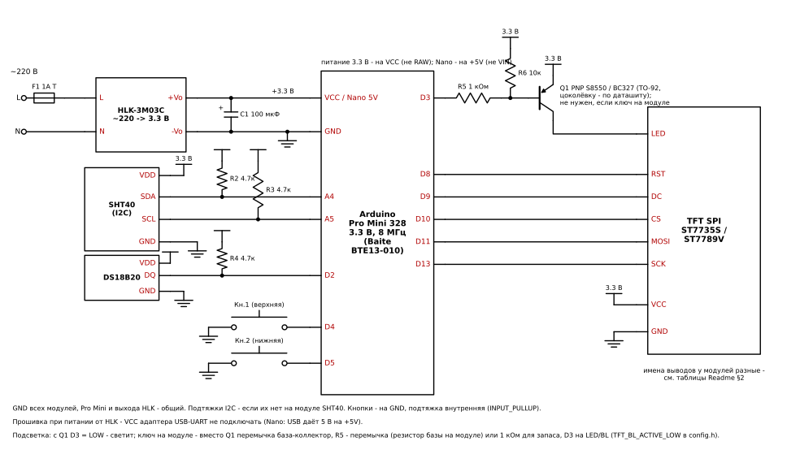

Схема генерируется скриптом `Scripts/schematic.py` (`Docs/schematic.svg`).

- **Питание и уровни:** всё устройство питается от 3.3 В (HLK-3M03C) - Pro Mini (на VCC, не на RAW), экран и
  датчик. Логика МК, экрана и SHT40 - 3.3 В, **преобразователи уровней не нужны**. ATmega328P при 3.3 В по
  даташиту допускает ~13 МГц, МК работает на 8 МГц (кварц 8 МГц у Pro Mini 3.3 В).
- **USB-UART и HLK одновременно - нельзя:** при прошивке от сети VCC адаптера не подключать (два источника 3.3 В
  параллельно); у запасной Nano USB подаёт 5 В на шину +5V - они попадут на выход HLK-3M03C, на экран и SHT40.
- **Экраны при 3.3 В:** 1.8" - перемычку J1 замкнуть (VCC = 3.3 В, стабилизатор модуля в обход); 1.77" - VCC
  3.0-5.0 В, подходит; 2.4" - на модуле стабилизатор, при 3.3 В на входе экран получит немного меньше
  (проверить на железе).
- **Подсветка:** 30-60 мА - больше допустимого тока вывода AVR. Если на модуле экрана нет своего ключа - ставится
  Q1 (PNP в корпусе TO-92, например S8550 / BC327; база через R5 1 кОм, R6 10 кОм база-эмиттер): D3 = LOW -
  подсветка горит (`TFT_BL_ACTIVE_LOW 1` в `config.h`). Если ключ на модуле есть - Q1 и R6 не нужны, D3
  прямо на LED/BL (`TFT_BL_ACTIVE_LOW 0`, HIGH - горит); **R5 - перемычкой**: резистор базы уже на модуле (1.8": ток
  BL при 3.3 В - 1.1 мА, то есть ~2.4 кОм - ОЦЕНКА по замеру). R5 1 кОм можно оставить для запаса (если поставят
  модуль без ключа - D3 не перегрузится): ток базы ~0.75 мА, транзистору модуля нужно усиление от ~40 (типичные
  SOT-23 - от 100) - проверить, что подсветка не тусклее. Проверка: ток вывода LED/BL при 3.3 В - единицы мА (ключ
  есть) или десятки мА (ключа нет). Подсветка - на D3 (таймер 2), а не на D6 (таймер 0 - это `millis()`): так
  частоту ШИМ можно поднять до 31 кГц (настройка «Яркость», §6).
- **SHT40:** питание 3.3 В, линии I2C подтянуть к 3.3 В (на многих модулях подтяжки уже есть).
- **DS18B20:** питание 3.3 В (допустимо 3.0-5.5 В), DQ подтянуть к 3.3 В резистором 4.7 кОм.
- **Сеть** (даташит [3W-C series](<Docs/3W-C series ac dc power module datasheet V2.9.pdf>), п. 6): на входе HLK -
  предохранитель F1 1 А / 250 В медленный (варистор 10D561K, который даташит тоже называет обязательным, в этой
  конструкции не ставится), на выходе - электролит C1 100-220 мкФ (пульсации до 30 мВ). HLK-3M03C: 3.3 В ±0.1 В,
  909 мА, рабочая температура -25...+60 °C.
- **Провод датчика на улицу:** 1-Wire (DS18B20) работает на десятках метров; I2C (SHT40) рассчитан на короткие
  линии, поэтому частота шины снижена до 20 кГц (минимум стандартной библиотеки Wire при 8 МГц - ~15 кГц); на
  длинном проводе при сбоях - подтяжки 2.2 кОм, витая пара или расширитель I2C.

### Плата кнопок и питания

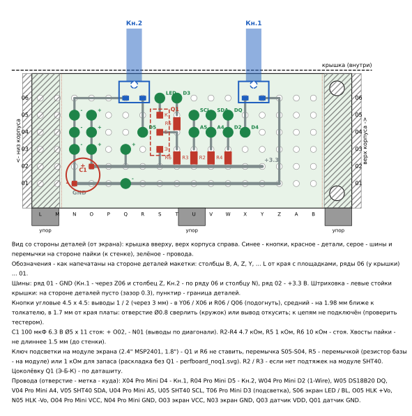

Макетная плата 20 x 80 мм (6 рядов, шаг 2.54, двусторонняя), обрезана после 17-го столбца - 20 x 47.6 мм.
Обозначения - как напечатаны на стороне деталей макетки (и на собранной плате ниже): столбцы B, A, Z, Y, ... L от
края с площадками, ряды 06 (у крышки) ... 01.
Рисунок - `Scripts/perfboard.py` (`Docs/perfboard.svg`), геометрия - из `Scripts/enclosure.py` (раскладка не
расходится с корпусом). **Экран с ключом подсветки на модуле** (2.4" MSP2401, 1.8") - раскладка без Q1 / R6:
D3 - R5 (1 кОм или перемычка) - LED / BL, `python Scripts/perfboard.py --no-q1`:

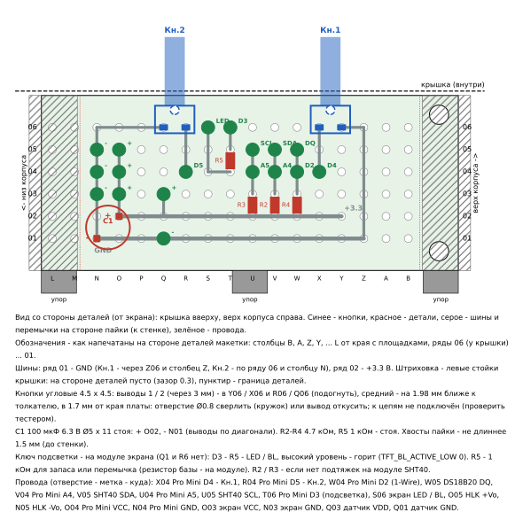
В корпусе плата стоит вертикально у левой стенки, стороной пайки к стенке, ряд 06 - к
крышке, столбец B - вверху (§7).

- **Кнопки** - угловые 4.5 x 4.5 мм (H = 11) на верхнем крае: выводы 1 / 2 (через 3 мм) - в Y06 / X06 (Кн.1) и
  R06 / Q06 (Кн.2), их подогнуть к шагу 2.54; средний вывод - на 1.98 мм ближе к толкателю (к краю платы, в
  1.7 мм от него), между столбцами: отверстие Ø0.8 сверлить или вывод откусить; к цепям не подключается (проверить
  тестером, что он не соединён с выводами 1 / 2).
- **Шины** на стороне пайки: ряд 01 - GND, ряд 02 - +3.3 В. GND кнопок - через ряд 06: Кн.1 - Z06 и столбец Z,
  Кн.2 - по ряду 06 до столбца N и вниз.
- **Детали** - только в столбцах B ... N (против L / M - нижняя левая стойка крышки, верхняя - за краем B; зазор
  0.3 мм): подтяжки R4 (1-Wire), R2 / R3 (I2C) 4.7 кОм, ключ подсветки Q1 с R5 1 кОм / R6 10 кОм - всё стоя;
  C1 100 мкФ 6.3 В Ø5 x 11 - стоя между столбцами питания (+ O02, - N01; Ø6.3 не помещается).
- **Провода:** питание - в столбцах O (+3.3) / N (GND): HLK - 05, Pro Mini - 04, экран - 03; датчик - Q03 / Q01;
  сигналы - в узлы подтяжек и ключа (метки на рисунке, таблица - в подписи). Хвосты пайки - не длиннее 1.5 мм.
- **Ключ подсветки на модуле экрана** (2.4" MSP2401, 1.8") - Q1 и R6 не ставить, перемычка S05-S04, R5 - перемычкой
  (или 1 кОм для запаса, см. «Подсветка» выше), `TFT_BL_ACTIVE_LOW 0`.
- Плата без саморезов: вставляется между левой стенкой и стойками крышки, стоит на 3 упорах с пазом (у торцов и
  по центру), сверху её держит крышка.
- **Оригинальная ATmega328P при 3.3 В** требует порог BOD не выше 2.7 В (фьюз; MiniCore при записи загрузчика
  ставит 2.7 В). С порогом 4.3 В чип при 3.3 В будет постоянно в сбросе.
- **Общая земля:** GND Pro Mini, экрана, датчика и выхода БП объединить.

**Собранный вариант** - другая плата и раскладка (`python Scripts/perfboard_v2.py`, `Docs/perfboard_v2.svg`):
кнопки 6 x 6, клеммник на 3 контакта под провод DS18B20 (+, DQ, -; + ближе к кнопкам), подтяжка DQ 4.7 кОм,
C1 и 0.1 мкФ параллельно по питанию.
Обозначения - как напечатаны на стороне деталей (буквы от края с площадками: B, A, Z, Y, ...; на стороне пайки
буквы свои: A пайки = B деталей). Разводка стороны пайки снята с фото - сверить. Дорисованы (ещё не на плате):
кнопки - один вывод к GND (Кн.1 - Y06 -> Y04, Кн.2 - R06 -> провод над рядом 06 -> Y06), другой - провод к D4 / D5
(X06 -> W06, Q06 -> Q05); DQ (S03) - провод к D2. Питание - у нижней стойки крышки: + - столбец P (P03 - P05),
GND - по ряду 01 (T01 -> O01) в столбец O (O02 - O04), сюда - провода HLK, Pro Mini и экрана. Стойки крышки (на уровне
правых): нижняя - против столбцов L / M, верхняя - за краем B; на стороне деталей там пусто.

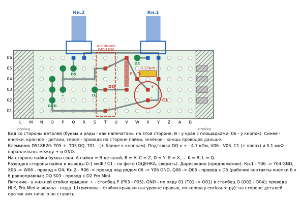

## 5. Как работает прошивка

| Файл (`TempDisplay/`) | Что делает |
|---|---|
| `src/main.cpp` | `setup()` / `loop()`: настройки, кнопки, экран, датчик, сторожевой таймер (режим сброса, 2 с) |
| `src/sensor.cpp` | определение датчика при включении (SHT40, затем DS18B20), опрос с периодом из настроек, повтор при ошибке, счётчики ошибок |
| `src/history.cpp` | средние за 2 мин (тенденция, 90 точек = 3 ч) и за 10 мин (график, 144 точки = 24 ч), мин / макс за каждый час (24 ч) |
| `src/buttons.cpp` | антидребезг 30 мс, короткое нажатие и долгое (от 1 с) |
| `src/settings.cpp` | настройки в EEPROM (метка, версия, CRC-8), при ошибке - умолчания |
| `src/ui.cpp` | экраны: главный, график, настройки (Readme §6) |
| `include/menu.h` | пункты настроек: порядок строк и названия - один список `MENU_ITEMS` |
| `include/config.h` | пины, цвета, периоды, пороги, параметры экрана и датчиков |
| `include/font_ui_*.h` | шрифт интерфейса (генерируется, см. ниже) |

- **Датчик:** SHT40 - свой код на Wire по даташиту SHT4x (команда, ожидание по `millis()`, чтение с CRC-8),
  высокая повторяемость, шина I2C 20 кГц с тайм-аутом (залипшая линия на проводе не вешает МК), прогрев - опция (§6);
  DS18B20 - DallasTemperature в асинхронном режиме (запуск, через 750 мс - чтение, 12 бит).
- **Крупные цифры** - 7-сегментные, рисуются прямоугольниками (без шрифта, масштабируются под экран).
- **Текст** - шрифт из DejaVu Sans (`Scripts/gen_font.py`: 12 px для 128x160, 20 px для 240x320). В шрифт
  попадают только символы, которые есть в строках `PSTR("...")` прошивки, и знаки чисел; буквы нумеруются
  подряд (таблица Unicode -> код). После изменения текстов на экране шрифт нужно перегенерировать.
- **Макет экранов без железа** - `Scripts/ui_mockup.py` (те же разметка, цвета и шрифт, что в прошивке).
- **Разбор занятой flash по группам** - `Scripts/flash_report.py [окружение]`.
- Кадрового буфера нет (ОЗУ 2 КБ): экран рисуется напрямую, перерисовываются только изменившиеся значения;
  цифры - посегментно (без мерцания).

Библиотеки (PlatformIO):

| Библиотека | Версия | Для чего |
|---|---|---|
| платформа `atmelavr` (ядро MiniCore, плата `ATmega328P`) | 5.3.0 | сборка, загрузка |
| Adafruit GFX Library | 1.13.0 | графика |
| Adafruit ST7735 and ST7789 Library | 1.12.0 | драйверы ST7735S / ST7789V |
| Adafruit ILI9341 | 1.7.0 | драйвер ILI9341 |
| OneWire | 2.3.8 | шина 1-Wire |
| DallasTemperature | 4.0.6 | DS18B20 |

Размер (2026-11-05, Pro Mini; Nano - на 12 б больше): 240x320 ST7789 - 30 088 б flash из 32 384, 1 174 б ОЗУ;
240x320 ILI9341 - 29 666 б, 1 173 б; 128x160 ST7735 - 29 796 б, 1 169 б.

## 6. Экран и управление

Ориентация экрана - альбомная (320x240 у 2.4", 160x128 у 1.8" / 1.77") или книжная (настройка «Поворот» 90 /
270°: 240x320, 128x160); разметка считается от размеров экрана.

Макет (`Scripts/ui_mockup.py`): 2.4" 320x240 и 1.8" / 1.77" 160x128, книжная - 240x320 и 128x160.

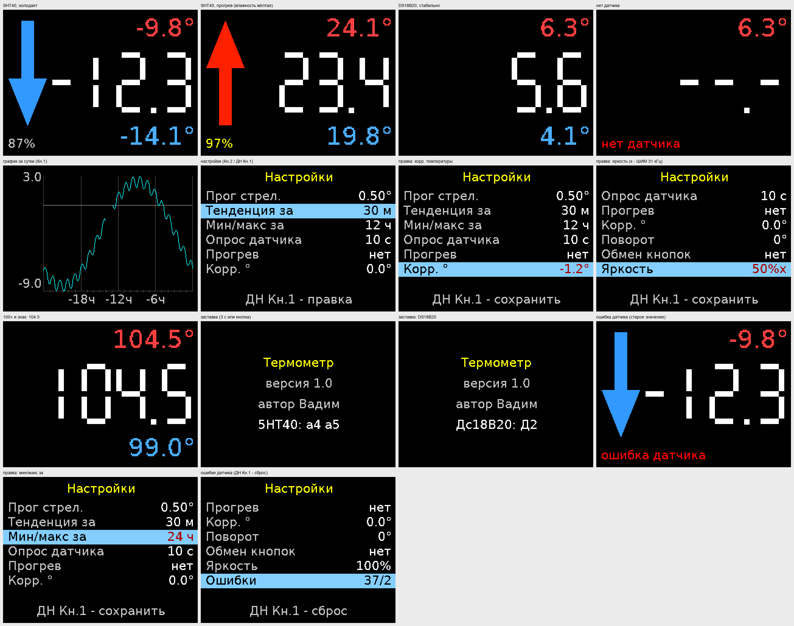

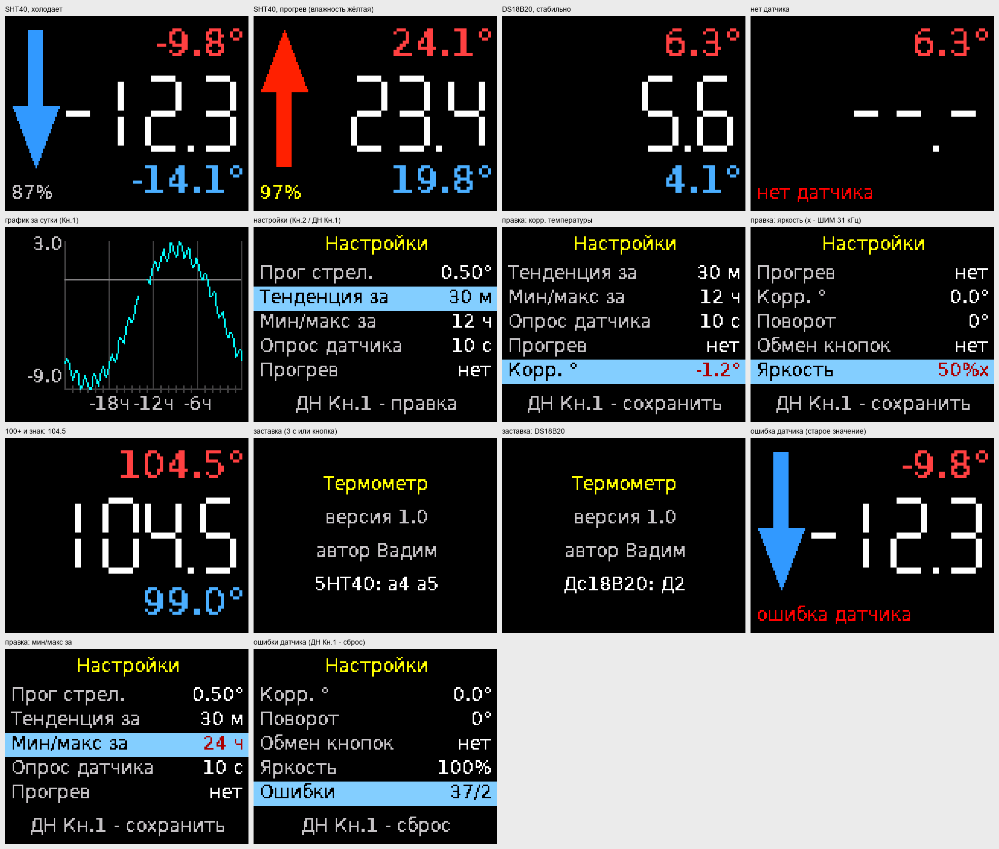

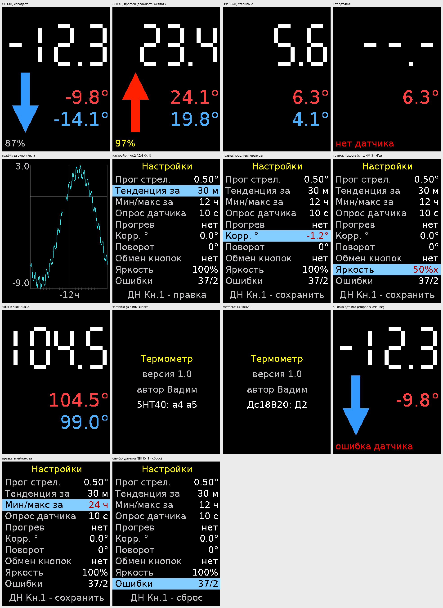

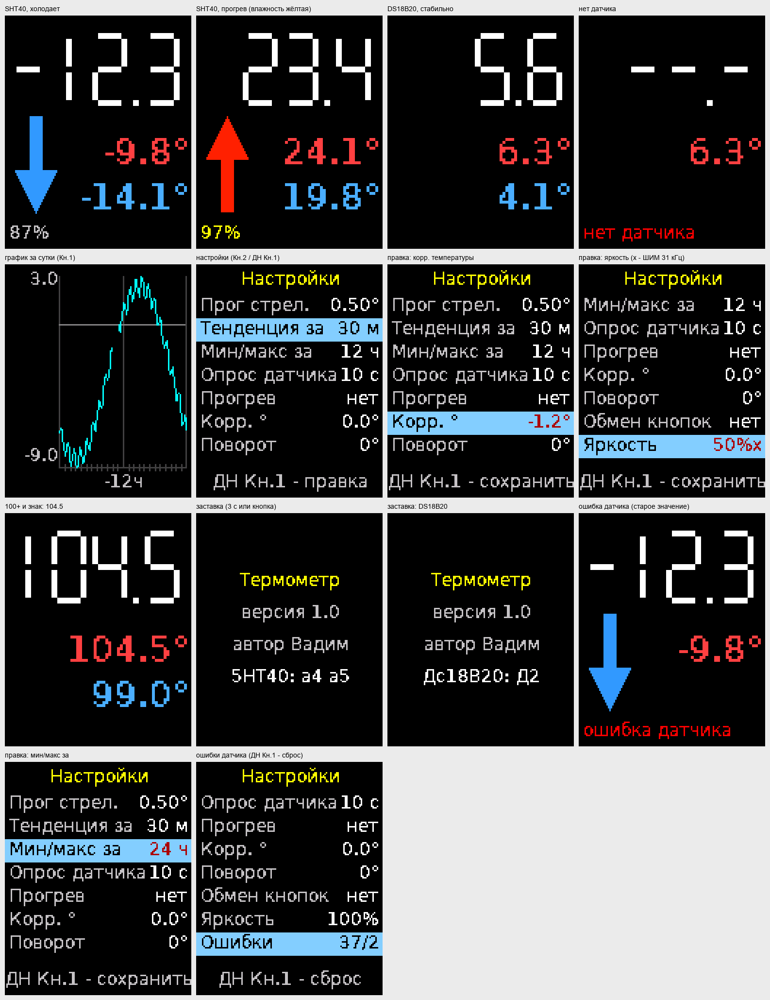

### Главный экран

```text
альбомная                                книжная
+------------------------------------+   +--------------+
|  ^                           23.4° |   |              |
|  |                                 |   |  22.8        |
|  |           22.8                  |   |              |
|  |                                 |   |   ^    23.4° |
| 85 %                        21.9°  |   |   |    21.9° |
+------------------------------------+   | 85 %         |
                                         +--------------+
```

- В центре (книжная - вверху) - текущая температура крупными цифрами (один знак после запятой), без значка
  градуса: цифры на 12 % крупнее (их размер ограничивает ширина экрана).
- Слева (книжная - слева от мин / макс) - стрелка тенденции: вверх красная (теплеет), вниз синяя (холодает) или нет стрелки (стабильно).
- Вверху справа - максимум (красный), внизу справа - минимум (книжная - двумя строками посередине между низом цифр и низом экрана; синий; шрифт вдвое крупнее подписей, без подписей; выровнены по
  правому краю под самое широкое значение - не скачут при смене числа знаков и «-») за последние 12 ч (настройка
  «Мин/макс за»: 1, 3, 6, 12, 24 ч) - по каждому измерению: хранятся мин и макс каждого часа (24 ч), окно -
  последние полные часы и текущий час. После включения - с момента включения.
- Внизу слева - относительная влажность (только с SHT40); жёлтая - датчик остывает после прогрева.
- Отрицательные температуры - со знаком «-» (DS18B20: -55...+125 °C, SHT40: -40...+125 °C).

### Включение и ошибки датчика

- **Заставка** (3 с или до любой кнопки, нажатие только закрывает её): «Термометр», версия прошивки
  (`FW_VERSION` в `config.h`), автор, найденный датчик и его выводы («5НТ40: а4 а5», «Дс18В20: Д2»
  или «нет датчика»; без слова «датчик» - помещается в книжную 128; кириллицей и цифрами - меньше знаков в шрифте). Подсветка включается, когда нарисованы первые
  три строки (без белого экрана и шума памяти экрана); строка датчика - после его определения, 3 с - от неё.
- **Датчик определяется один раз - при включении** (сначала SHT40, затем DS18B20). Не найден - «- - -» и «нет
  датчика» до перезапуска.
- **Ошибка чтения** - повтор, до 10 раз (`SENSOR_RETRIES`): SHT40 - новое измерение через 100 мс
  (`SHT_RETRY_MS`; ошибка - нет ответа на I2C или не сошлась CRC), DS18B20 - заново преобразование и чтение через
  100 мс (`DS18B20_RETRY_MS`; ошибка - нет ответа на шине 1-Wire или не сошлась CRC блокнота). Все повторы неудачны - измерение пропало: на экране остаётся
  последняя температура, внизу слева красная надпись «ошибка датчика» (вместо минимума и влажности); опрос продолжается с
  обычным периодом, первое удачное измерение надпись убирает.
- Счётчики ошибок с включения - в настройках, пункт «Ошибки»: «неудачных чтений / пропавших измерений»
  (включая повторы), ДН Кн.1 на пункте - сброс.

### Тенденция

- Период тенденции по умолчанию - **1 час** (настройка: 15, 30, 60, 120, 180 мин). На улице температура
  почти всегда меняется (утром растёт, вечером падает на 0.5-2 °C в час), поэтому стрелка показывает «теплеет /
  холодает», а порог отсекает порывы ветра и солнце.
- Хранятся средние за 2 мин (до 3 ч - 90 точек). Изменение за период - по наклону прямой (метод наименьших
  квадратов) по точкам периода, умноженному на период. Стрелка - если изменение не меньше порога за период
  (настройка, по умолчанию 0.5 °C).
- После включения стрелки нет, пока не накопится половина периода.

### График за сутки

- Короткое нажатие Кн.1 на главном экране - график за последние 24 ч: точки - средние за 10 мин (144 точки).
- Ось времени справа налево: у правого края - сейчас, слева - самое старое; засечки каждый час, подписи -6ч,
  -12ч, -18ч (подпись каждого часа по ширине экрана не помещается; в книжной 128 - только -12ч).
- Ось температуры - автомасштаб по мин / макс за сутки.
- Первая точка - через 10 мин после включения, до этого на экране «точки через 10 мин».
- История - в ОЗУ, после выключения начинается заново.

### Кнопки

Короткое нажатие (КН) - меньше 1 с, долгое (ДН) - 1 с и дольше.

Кн.1 - верхняя, Кн.2 - нижняя (при настройке «Обмен кнопок» «да» - наоборот).

| Экран | Кн.1 (верхняя) | Кн.2 (нижняя) |
|---|---|---|
| Главный | КН - график; ДН - настройки | КН - настройки |
| График | КН - главный экран | КН - главный экран |
| Настройки, выбор пункта | КН - пункт выше (по кругу); ДН - правка пункта («Ошибки» - сброс) | КН - пункт ниже; ДН - выход |
| Настройки, правка | КН - значение «+» (по кругу); ДН - сохранить, к списку | КН - значение «-»; ДН - выход без сохранения |

Из настроек и графика - автовыход на главный экран через 30 с без нажатий (несохранённая правка отменяется).

### Настройки (EEPROM)

| Пункт | Значения | По умолчанию |
|---|---|---|
| Период опроса датчика | 2, 5, 10, 20, 30, 60 с | 10 с |
| Период тенденции | 15, 30, 60, 120, 180 мин | 60 мин |
| Прог стрел. (порог стрелки тенденции) | 0.02 ... 2.00 °C, шаг 0.02 | 0.50 °C |
| Прогрев | нет / да | нет |
| Корр. ° | -5.0 ... +5.0 °C, шаг 0.1 | 0.0 °C |
| Поворот | 0°, 90°, 180°, 270° | 0° |
| Обмен кнопок | нет / да | нет |
| Яркость | 25%, 25%x, 50%, 50%x, 75%, 75%x, 100% (x - ШИМ 31 кГц, без x - 490 Гц) | 100% |
| Мин/макс за | 1, 3, 6, 12, 24 ч | 12 ч |
| Ошибки | только показ: неудачных чтений / пропавших измерений с включения, ДН Кн.1 - сброс (не в EEPROM) | - |

**Прогрев датчика** (только SHT40, даташит SHT4x, разд. 4.9) - сушка встроенным нагревателем от конденсата и
дождя: при влажности от 95 % - импульс 110 мВт на 1 с, не чаще раза в 5 мин (скважность 0.3 %, допустимо до 10 %),
только ниже 60 °C. **Температура важнее:** измерение с нагревом не используется, и ещё 2 мин после импульса
показания не обновляются (на экране и в истории - последнее значение до прогрева). Время остывания подбирается
на железе (`HEATER_COOLDOWN_S` в `config.h`). Импульс нагрева - около 33 мА по проводу датчика.

**Корр. °** - поправка к температуре датчика (например, датчик на солнце или у стены дома): прибавляется ко всем
показаниям - на экране, в истории, мин / макс, графике и тенденции (уже накопленная история не пересчитывается).
Прогрев SHT40 включается по сырой температуре датчика. Диапазон ±5 °C - `TEMP_CORR_MAX_C10` в `config.h`.

Период тенденции меньше часа в настройках - с «м» («30 м»): «мин» налезает на название пункта на узком экране.

**Поворот** - экран на 0 / 90 / 180 / 270° от штатной ориентации; 90 и 270° - книжная разметка. У TN-матрицы
(1.8" и т. п.) угол обзора узкий по одной оси панели - в книжной ориентации плохой угол уходит вверх / вниз, сбоку
видно лучше. Применяется сразу после сохранения. **Обмен кнопок** - Кн.1 / Кн.2 местами (корпус повёрнут - верхняя
остаётся Кн.1), отдельно от поворота.

**Яркость** - ШИМ подсветки на D3 (таймер 2): обычные значения - 490 Гц, «x» - 31 кГц (не мерцает). Меняется сразу
при правке (отмена правки - назад). Угол обзора TN-матрицы яркость не исправляет (контраст сбоку тот же) - только
меньше слепит ночью.

Настройки хранятся в начале EEPROM с номером версии и контрольной суммой; при ошибке - значения по умолчанию
(версия 6 - «Поворот», «Обмен кнопок», «Яркость», «Корр. °»: настройки прежних прошивок сбросятся на умолчания).
Запись - только при сохранении изменённого пункта.

## 7. Корпус

Скрипт `Scripts/enclosure.py` (CadQuery), все размеры - параметрами с указанием источника. Варианты - по экрану,
у каждого свой корпус и крышка: **1.8"** (по умолчанию), **1.77"**, **2.4"** (габариты - таблица ниже); плата
**Arduino Pro Mini** (аналог Baite BTE13-010, прошивка через USB-UART 3.3 В при снятой крышке) или запасная -
клон **Nano** на её месте. Корпус - на стену.

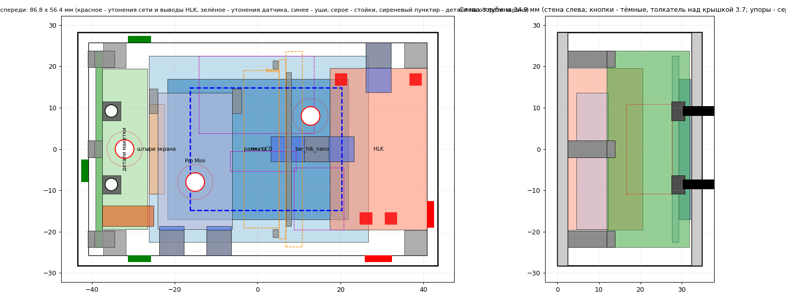

Корпус - горизонтально, размер - по экрану с крепежом; кнопки - на крышке слева от экрана. Углы корпуса и крышки
скруглены (R 4 мм снаружи, внутри полости - R 1.5, стенка в углу та же 2.5 мм), дно и лицо крышки - плоские.

- **Крышка:** окно экрана (видимая область + 0.8 мм), экран альбомно, гребёнкой влево - на 4 полных стойках крышки
  (размеры - по чертежам продавцов, §2). Крышка с бортиком внутрь корпуса, 4 самореза Ø2.5 x 12 в стойки корпуса:
  2 - у макетки (между ними и стенкой - макетка), 2 - в правых углах, за торцами HLK (слиты с двумя стенками); на
  лице крышки - небольшой конус 90° Ø4.4 мм под головку (глубина 0.8 мм).
- **Крепёж - саморезы Ø2.5** в глухие отверстия Ø2.0 (резьбу нарезает сам). Глубина отверстия = длина самореза -
  толщина прижимаемой детали + запас у дна 1.5 мм: крышка - 2.5 x 12 (глубина 11), уши HLK и планка - 2.5 x 8 (7.5),
  уши Pro Mini - 2.5 x 6 (5.5). **Экран - короткие саморезы** (стойки под экраном низкие - толщина стекла, отверстие
  уходит в крышку на 1 мм): 2.4" и 1.8" - 2.5 x 5, 1.77" - 2.2 x 4 (отверстия модуля Ø2.5); длиннее - упрётся и может
  выдавить лицо крышки. Запас каждого самореза проверяет скрипт (таблица ниже).
- **Кнопки** - угловые 4.5 x 4.5 мм, 3 вывода (`Docs/Button 4.5x4.5 3P Rgiht Angle.avif`), H = 11 мм, на крышке
  слева от экрана, примерно по центру экрана по высоте: толкатели Ø2.3 - в отверстиях Ø3.0, выступают над крышкой
  на 1.6 мм. Макетка (17 столбцов, 47.6 x 20 мм) стоит вертикально у левой стенки, стороной пайки к стенке (зазор
  1.75 мм - хвосты выводов и бортик крышки), кнопки - на её верхнем крае (выводы 1 / 2 - в ряду 06, у крышки), без
  саморезов: вставляется сверху между стенкой и левыми стойками крышки, стоит на 3 упорах с пазом (у торцов - у этих стоек, и по центру),
  сверху её держит крышка (зазор 0.5 мм); нажатие передаётся на упоры. Выводы кнопки (через 3 мм, средний - на 2 мм
  ближе к толкателю) в сетку 2.54 не попадают - подогнуть или рассверлить. Детали макетки (со стороны кнопок) - между
  стойками крышки (±19.4 мм от середины корпуса по высоте). Все 4 стойки крышки - на одной высоте: за торцами HLK,
  ±22.45 мм от середины (3.25 мм от верхней / нижней стенки до оси), левые и правые слиты с верхней / нижней стенкой.
- **HLK-3M03C** - лёжа, выводами к крышке, длинной стороной вплотную к правой стенке, по центру по высоте, выводы
  сети (AC) - внизу. Выводы после пайки проводов откусить до ~3 мм; над HLK до платы экрана - выводы + детали на
  обороте экрана + 0.5 мм (таблица ниже). Держится на двух стойках: слева по центру - общая планка HLK + Nano 2.5 мм,
  у верхнего торца (слита с верхней стенкой) - ухо 12 x 6 x 2 мм; саморезы Ø2.5 x 8.
- **Pro Mini** - вертикально, край RESET вниз, на 5 мм над задней стенкой (снизу помещаются хвосты штырьков). У края
  UART (вверху) - 2 держателя шириной 5 мм ([эскиз](work/ProMini_holder_sketch.png)): полка под краем платы, паз,
  губа 0.5 мм с фаской - плата ставится сверху и защёлкивается; торец паза закрыт (упор по длине). Разъём USB-UART -
  на прямых штырях, сверху при снятой крышке. У края RESET - 2 стойки за краем платы (слиты с нижней стенкой), на
  каждой ухо на саморезе Ø2.5 x 6: прямоугольное, с узким язычком 1.8 мм, который заходит на край платы на 0.8 мм
  между угловым выводом (D9 / D10) и A4 / A7 - отверстия выводов не перекрывает; под язычком - полочка.

  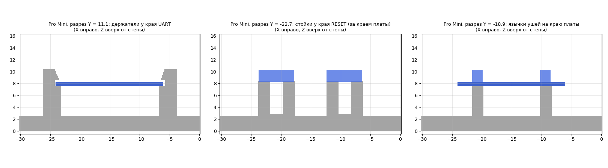

- **Nano (запасная, вместо Pro Mini)** - на ребре вдоль высоты корпуса, штырьками влево (к месту Pro Mini), стороной
  деталей - к левой стойке HLK. Сверху её держит общая планка на левой стойке HLK: паз над верхним ребром между двумя
  выступами на тех же местах, что и выступы на дне (справа - 1 мм, не задевает хвосты штырьков; слева - 0.3 мм, выше
  пластика колодки); снизу - низкие выступы на задней стенке (справа вдоль платы 0.8 мм, слева - у торцов, где нет
  штырьков). Размеры Nano - типовые (43.2 x 18.5 мм), измерить.
- **Уши и планка** - отдельные детали (`TempDisplay_tft<вариант>_ears.stl`: планка HLK + Nano, ухо HLK, 2 уха Pro Mini; печать
  плашмя, планка - верхом на столе).
- **Провода:** вместо отверстий - **утонения** (изнутри, остаток стенки 0.8 мм, снаружи гладко), сверлить по месту.
  Датчик Ø5.5 - левая стенка (под макеткой), низ и верх слева; сеть Ø6.5 - у выводов AC: правая стенка выше HLK, нижняя
  стенка у дна, на уровне утонения датчика (провод - в зазоре у нижнего торца HLK, вверх к выводам). Утонения не упираются в стойки и детали (проверяет скрипт).
- **На стену** - 3 места под шуруп Ø4: утонения Ø4.5 в задней стенке изнутри (остаток 0.8 мм), сверлить нужные:
  слева посередине (под макеткой), под Pro Mini, слева от HLK - посередине между HLK и выступом Nano, на 8 мм
  выше левой стойки HLK. Над ними до крышки нет стоек корпуса (проверяет скрипт);
  макетку, Pro Mini или HLK на время монтажа снять.
- **Печать без поддержек:** корпус - задней стенкой на столе, крышка - лицом на столе, уши - плашмя.
- **Отверстия под винты и толкатели** в модели больше на `HOLE_COMP` (параметр `Scripts/enclosure.py`): при печати
  (сопло 0.3, периметры 0.4, шов случайный) Ø3.0 выходило 2.2, Ø2.8 - 1.9. Другие настройки слайсера или принтер -
  напечатать пробу (`_ears.stl`), перемерить и поправить `HOLE_COMP`.

Плата - аналог Pro Mini **Baite BTE13-010**, 33 x 18 мм (измерено). Размеры экранов - по чертежам продавцов (§2);
у 1.8" и 1.77" положение деталей на обороте и часть размеров (толщина скотча, ширина рамки LCD 1.77") - оценка по
рисунку.

**Проверить по месту:** размеры Nano и высоту её деталей (разъём USB ~4 мм); ширину макетки (20 мм - от упоров до
крышки) и хвосты пайки (до 1.5 мм);
детали на обороте экрана (положение - по рисунку чертежа, ±1 мм). Раскладка макетки (17 столбцов) - §4,
«Плата кнопок и питания».

```sh
PYTHONIOENCODING=utf-8 python Scripts/enclosure.py --tft 18         # один вариант (18 / 177 / 24) - Build/enclosure/
PYTHONIOENCODING=utf-8 python Scripts/enclosure.py --all             # все варианты
PYTHONIOENCODING=utf-8 python Scripts/enclosure.py --update-project  # все варианты + таблица ниже
```

<!-- enclosure-params -->

| Параметр | 2.4" LCDWIKI MSP2401 240x320 | 1.8" 128x160 ST7735S | 1.77" 128x160 ST7735S |
|---|---|---|---|
| Экран | 2.4" LCDWIKI MSP2401 240x320, плата 42.7 x 77.2 | 1.8" 128x160 ST7735S, плата 45.0 x 53.0 | 1.77" 128x160 ST7735S, плата 34.0 x 53.7 |
| Габарит, мм | 102.6 x 56.4 x 34.0 | 86.8 x 56.4 x 34.9 | 86.8 x 56.4 x 31.9 |
| Стенки / задняя / крышка, мм | 2.5 / 2.5 / 2.5 | то же | то же |
| Окно экрана, мм | 50.6 x 38.3 | 36.6 x 29.6 | 36.6 x 29.6 |
| Крышка | 4 самореза Ø2.5 x 12 в стойки корпуса (глухое Ø2.0 глубиной 11.0), на лице - конус Ø4.4 под головку | то же | то же |
| Экран на крышке | 4 самореза Ø2.5 x 5 (не длиннее) в стойки Ø6.0 (глухое Ø2.0 глубиной 3.9) | 4 самореза Ø2.5 x 5 (не длиннее) в стойки Ø5.3 (глухое Ø2.0 глубиной 4.2) | 4 самореза Ø2.2 x 4 (не длиннее) в стойки Ø4.4 (глухое Ø1.8 глубиной 3.7) |
| Саморезы: запас у дна | крышка в стойки корпуса 2.5 x 12 - 1.5, ухо HLK 2.5 x 8 - 1.5, планка HLK + Nano 2.5 x 8 - 2.0, уши Pro Mini 2.5 x 6 - 1.5, плата экрана в стойки крышки 2.5 x 5 - 0.5 | крышка в стойки корпуса 2.5 x 12 - 1.5, ухо HLK 2.5 x 8 - 1.5, планка HLK + Nano 2.5 x 8 - 2.0, уши Pro Mini 2.5 x 6 - 1.5, плата экрана в стойки крышки 2.5 x 5 - 0.8 | крышка в стойки корпуса 2.5 x 12 - 1.5, ухо HLK 2.5 x 8 - 1.5, планка HLK + Nano 2.5 x 8 - 2.0, уши Pro Mini 2.5 x 6 - 1.5, плата экрана в стойки крышки 2.2 x 4 - 0.9 |
| Кнопки | угловые 4.5 x 4.5, H = 11, на крышке слева от экрана (отверстия Ø3.0, толкатель над крышкой 3.7); макетка 20.0 x 47.6 вертикально у левой стенки - между стенкой и стойками крышки, на 3 упорах с пазом, сверху держит крышка | то же | то же |
| Pro Mini | вертикально, на высоте 5.0 над стенкой; у края UART 2 держателя с пазом, у края RESET 2 стойки + 2 уха с язычком, саморезы Ø2.5 x 6 | то же | то же |
| Nano (запасная) | вместо Pro Mini: на ребре вдоль Y у левой стойки HLK, штырьки влево; общая планка HLK + Nano (паз и Г-загиб над ребром), низкие выступы у задней стенки | то же | то же |
| HLK-3M03C | лёжа выводами к крышке, длинной стороной у правой стенки, по центру, AC внизу; до платы экрана 6.5; стойка слева - планка HLK + Nano 2.5 мм, стойка у верхнего торца - ухо 12 x 6 x 2; саморезы Ø2.5 x 8 | лёжа выводами к крышке, длинной стороной у правой стенки, по центру, AC внизу; до платы экрана 7.1; стойка слева - планка HLK + Nano 2.5 мм, стойка у верхнего торца - ухо 12 x 6 x 2; саморезы Ø2.5 x 8 | лёжа выводами к крышке, длинной стороной у правой стенки, по центру, AC внизу; до платы экрана 5.1; стойка слева - планка HLK + Nano 2.5 мм, стойка у верхнего торца - ухо 12 x 6 x 2; саморезы Ø2.5 x 8 |
| На стену | 3 места под шуруп Ø4 - утонения Ø4.5 (остаток 0.8), сверлить нужные: (-40; 0), (-23; -8), (21; 5) (на время монтажа снять макетку, Pro Mini или HLK) | 3 места под шуруп Ø4 - утонения Ø4.5 (остаток 0.8), сверлить нужные: (-32; 0), (-15; -8), (13; 8) (на время монтажа снять макетку, Pro Mini или HLK) | 3 места под шуруп Ø4 - утонения Ø4.5 (остаток 0.8), сверлить нужные: (-32; 0), (-15; -8), (13; 8) (на время монтажа снять макетку, Pro Mini или HLK) |
| Утонения | датчик Ø5.5 (левая, нижняя и верхняя слева), сеть Ø6.5 (у AC: правая над HLK, нижняя у дна); остаток 0.8 | то же | то же |

<!-- /enclosure-params -->

## 8. Структура репозитория

```text
Docs/          описания экранов, даташиты HLK и кнопок, схема schematic.svg, плата perfboard.svg (без ключа подсветки - perfboard_noq1.svg), фото и эскизы
Tests/         тестовые программы для МК: ChipInfo/ (тип чипа, фьюзы, стресс-тест)
Scripts/       утилиты: make_flash_zip.py (архив для прошивки), enclosure.py (корпус), eagle_brd_info.py (отверстия из .brd), gen_font.py (шрифт интерфейса), ui_mockup.py (макет экранов), flash_report.py (разбор flash), schematic.py (схема подключения), perfboard.py / perfboard_v2.py (плата кнопок), usb_uart.py (подключение USB-UART), copy_hex.py, chipinfo_crc_ref.py (hex в Build/), display_select.py / upload_select.py (выбор экрана и загрузчика), flash.bat (прошивка hex без PlatformIO), readme_toc.py, pdf_to_text.sh, pdf_to_png.py, docx_to_text.py
Tools/         avrdude/ - avrdude 8.1 для Windows с avrdude.conf (GPL-2, LICENSE.txt) - для flash.bat
TempDisplay/   исходники прошивки: include/config.h, src/main.cpp
platformio.ini проект PlatformIO (в корне; исходники - в TempDisplay/)
Build/         готовые прошивки TempDisplay_<окружение>.hex, корпуса enclosure/
work/          рабочие файлы (текст даташитов, картинки)
Journal.md     журнал изменений
```

### Сборка и прошивка

Команды - из корня репозитория (PlatformIO; в VS Code - кнопки окружений в строке состояния). Прошивка - через
USB-UART 3.3 В (Pro Mini) или USB платы (Nano) при отключённом HLK; монитор порта перед загрузкой закрыть.

| Кварц / работа | Окружение TempDisplay / ChipInfo | Платы |
|---|---|---|
| 8 / 8 МГц | `nano8` (по умолчанию) | Pro Mini 3.3 В (основная) |
| 16 / 8 МГц (делитель CLKPR) | `nano16` | Nano (запасная), Pro Mini 16 МГц |

Окружения различаются только кварцем: скорость загрузчика и делитель частоты при старте; код и распиновка общие.
Прошивку одного окружения в плату с другим кварцем не заливать - все времена и Serial будут вдвое быстрее / медленнее.

**Загрузчик платы** - секция `[upload]` `bootloader` в `platformio.ini` (и своя - в `Tests/ChipInfo/platformio.ini`),
разово - переменная окружения `BOOTLOADER`; протокол, скорость и лимит размера программы ставит
`Scripts/upload_select.py` (скорость - по кварцу платы):

| `bootloader` | Загрузчик | Протокол avrdude | Скорость 8 / 16 МГц | Размер | Под программу |
|---|---|---|---|---|---|
| `urboot` (по умолчанию) | MiniCore urboot (записать программатором, «Новая плата») | `urclock` | 57600 / 57600** | 384 б | 32 384 б |
| `optiboot` (`new`) | Optiboot - «новый» загрузчик Nano / Uno, стандартный у китайских Nano | `arduino` | 57600* / 115200 | 512 б | 32 256 б |
| `atmegaboot` (`old`) | ATmegaBOOT - штатный Pro Mini, «Old Bootloader» Nano | `arduino` | 57600 / 57600 | 2 КБ | 30 720 б |

\* Optiboot на 8 МГц - ОЦЕНКА / ПРОВЕРИТЬ чтением подписи (другая скорость - переменная `BOOT_SPEED`). Какой
загрузчик на плате - «Новая плата», чтение подписи.
\*\* urboot на 16 МГц - тоже 57600: на 115200 у клона Nano загрузка сбоит (ошибка UART 16 МГц / 115200 ~2.1 %;
проверено: 0 из 4 загрузок, на 57600 - 4 из 4).

Экран - секция `[display]` в `platformio.ini` (§2). Разовая сборка под другой экран без правки файла - переменные
окружения `LCD_RES` / `LCD_CTRL`.

```sh
pio run -e nano8                       # TempDisplay: сборка (Pro Mini, экран из [display])
pio run -e nano8 -t upload             # TempDisplay: сборка и загрузка
pio run -e nano16 -t upload                # то же для Nano
LCD_RES=128x160 LCD_CTRL=ST7735 pio run -e nano8   # разово - другой экран (PowerShell: $env:LCD_RES=...)
BOOTLOADER=old pio run -e nano16 -t upload # разово - другой загрузчик (PowerShell: $env:BOOTLOADER="old")
pio device monitor                       # монитор порта (38400)

pio run -d Tests/ChipInfo -e nano8 -t upload   # ChipInfo на Pro Mini
pio run -d Tests/ChipInfo -e nano16 -t upload      # ChipInfo на Nano (старый загрузчик: BOOTLOADER=old ...)
pio device monitor -d Tests/ChipInfo             # монитор порта (38400)
```

Готовые hex (копирует `Scripts/copy_hex.py` после сборки): `Build/TempDisplay_<окружение>_<res>_<ctrl>.hex`,
`Build/ChipInfo_<окружение>.hex` - их можно залить и без PlatformIO (avrdude, протокол и скорость - по таблице загрузчиков).

Новая плата или штатный загрузчик (не MiniCore) - см. «Новая плата» ниже.

Флаги сборки: `-Os`, `-Wstrict-aliasing=1`, `-fpack-struct`, `-DWIRE_TIMEOUT`; `f_cpu` 8 МГц; у `nano16` ещё
`-DOSC_PRESCALER=0x01` (делитель 2 включает ядро MiniCore в `init()`, загрузчик работает до этого на 16 МГц).

### Новая плата: загрузчик, ChipInfo, прошивка

Порядок для любой новой платы (Pro Mini или Nano): **1)** загрузчик MiniCore urboot и фьюзы - программатором ISP
(один раз; штатный загрузчик Pro Mini / Nano не подходит под `urclock`), **2)** `ChipInfo` - тип чипа, фьюзы,
загрузчик, проверка при 3.3 В (§8, «Проверка микроконтроллера»), **3)** основная прошивка TempDisplay.
Без программатора можно обойтись штатным загрузчиком (см. ниже), но тогда ChipInfo покажет его, а не urboot.

**Подключение программатора** (USBasp или Arduino Uno со скетчем ArduinoISP): MOSI - D11, MISO - D12, SCK - D13,
RESET - RST (у Arduino as ISP - с вывода D10 Uno), GND, VCC. Плата - **без экрана, датчика и HLK** (экран сидит на тех
же D11 / D13); питание от программатора 3.3 В (перемычка USBasp), 5 В - только голой плате. У Nano - разъём ICSP
2x3 у торца с VIN / RX / TX: 1 MISO, 2 +5V, 3 SCK, 4 MOSI, 5 RESET, 6 GND (официальная распиновка Arduino Nano,
[Docs/Nano pinout A000005.pdf](<Docs/Nano pinout A000005.pdf>), стр. 3; CC BY-SA 4.0):

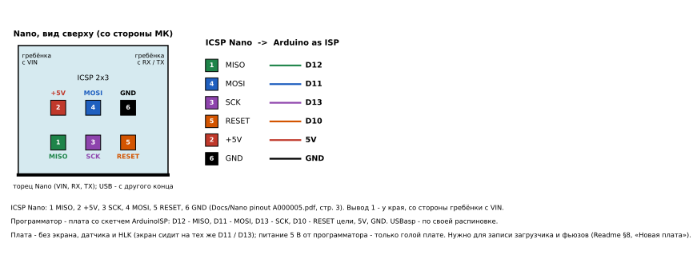

**Подключение USB-UART** (ChipInfo и прошивка): адаптер 3.3 В - GND, VCC (только при отключённом HLK), TX - RXI,
RX - TXO, DTR - DTR платы (автосброс). Нет DTR - нажать RESET в момент начала загрузки (загрузчик ждёт 1 с).
Nano - свой USB или внешний адаптер: TX - RX0, RX - TX1, DTR - RST через 0.1 мкФ (у Nano нет вывода DTR).
Монитор порта перед загрузкой закрыть.

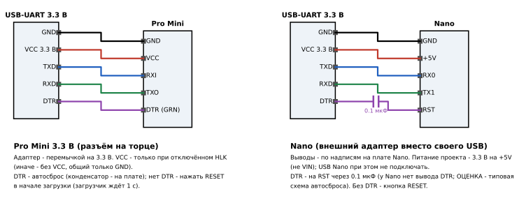

Рисунок - `python Scripts/usb_uart.py`. Выводы Pro Mini - по распиновке продавца (разъём на торце: BLK / GND, GND,
VCC, RXI, TXO, GRN / DTR), Nano - по надписям на плате. Конденсатор автосброса у Nano - типовая схема Arduino
(ОЦЕНКА): нет его - нажать RESET в начале загрузки.

Загрузчик - `urboot_atmega328p_pr_ee_ce.hex` из MiniCore 3.1.2 (последняя в реестре PlatformIO; в 3.1.3 изменён
только отладчик PyAvrOCD для Arduino IDE, загрузчики те же) (копия - [Build/](Build/)): autobaud (один файл
для кварца 8 и 16 МГц), сторож 1 с, светодиод D13. Фьюзы: **L 0xF7** (внешний кварц), **H 0xD7** (EEPROM
сохраняется при стирании), **E 0xFD** (BOD 2.7 В - нужен для работы от 3.3 В), lock 0xFF. Запись загрузчика стирает
flash.

**PlatformIO, VS Code:** боковая панель PlatformIO -> Project Tasks:

| Шаг | Где | Задача |
|---|---|---|
| 1. Загрузчик и фьюзы | `env:isp` -> Platform | Burn Bootloader |
| 2. ChipInfo | открыть папку `Tests/ChipInfo`, `env:nano8` (Nano - `env:nano16`) -> General | Upload, затем Monitor |
| 3. TempDisplay | корень репозитория, экран - `[display]` в `platformio.ini`, `env:nano8` / `env:nano16` -> General | Upload, Monitor |

Программатор - в `[env:isp]` `platformio.ini`: Arduino as ISP (`stk500v1`, `-PCOM7 -b115200` - скетч ArduinoISP
на 115200, в Arduino IDE «Arduino as ISP fast»; штатный скетч - 19200; COM7 - порт платы-программатора); USBasp -
`upload_protocol = usbasp`, `upload_flags = -B 10`. Перед записью - чтение подписи (без `-U`): `1E 95 0F` - можно
писать; `00 00 00` или `FF FF FF` при отвечающем программаторе (`FW Version 1.18` у ArduinoISP) - обрыв провода
ISP / RESET, ключ `-F` не использовать.

**PlatformIO, командная строка** (из корня репозитория; порт выбирается сам, иначе `--upload-port COM5`):

```sh
pio run -e isp -t bootloader                      # 1. фьюзы и загрузчик (программатор)
pio run -d Tests/ChipInfo -e nano16 -t upload    # 2. ChipInfo (Nano: -e nano8)
pio device monitor -d Tests/ChipInfo              #    отчёт, 38400; команды r, l, k, w
pio run -e nano16 -t upload                      # 3. TempDisplay (Nano: -e nano8)
```

**На компьютере, где ничего не установлено** - архив [`Build/TempDisplay_flash.zip`](Build/TempDisplay_flash.zip): распаковать
и запустить `flash.bat` двойным щелчком, он сам спросит файл прошивки, порт и нужен ли сброс кнопкой RESET. В архиве -
avrdude и готовые hex (обновляется после каждой сборки, `Scripts/make_flash_zip.py`). Нужен только драйвер USB-UART адаптера (CH340, FT232),
обычно Windows ставит его сама.

**Без среды разработки, проще всего** - `Scripts\flash.bat` (Windows, двойной щелчок или из консоли; если в окне
консоли становится мелкий шрифт - в свойствах окна выбрать шрифт Consolas или Lucida Console): покажет
hex из `Build/` на выбор и порты, прошьёт загрузчиком urboot и сверит, при сбое повторит до 3 раз. Параметры -
в любом порядке (`*.hex` - файл, `COMn` - порт, число - скорость, `urclock` / `arduino` - протокол, `reset` - адаптер
без DTR: нажать Enter, затем, пока идут строки «not in sync», нажать и отпустить RESET платы), чего нет - спросит:

```bat
Scripts\flash.bat                                                  :: всё спросит
Scripts\flash.bat COM5 Build\TempDisplay_nano16_240x320_ST7789.hex :: порт и файл
Scripts\flash.bat COM5 Build\TempDisplay_nano16_240x320_ST7789.hex 19200            :: сбои - скорость ниже
Scripts\flash.bat COM5 Build\TempDisplay_nano8_240x320_ST7789.hex 57600 arduino     :: штатный загрузчик
Scripts\flash.bat COM7 Build\TempDisplay_nano16_128x160_ST7735.hex reset            :: нет DTR - RESET вручную
```

hex - под кварц платы (`nano8` / `nano16`) и экран (`<res>_<ctrl>`): avrdude пишет файл как есть, экран другого
разрешения в прошивке - другой hex. Скорость не задана и на 57600 не прошилось - батник сам пробует 19200.
avrdude 8.1 с `avrdude.conf` и лицензией (GPL-2) - в [Tools/avrdude/](Tools/avrdude/), ничего ставить не нужно
(нет папки - avrdude из PlatformIO, затем из PATH; источник - github.com/avrdudes/avrdude/releases).

**Без среды разработки, командами** - avrdude 7.1 и новее (протокол `urclock`; есть в PlatformIO:
`%USERPROFILE%\.platformio\packages\tool-avrdude\`, или отдельно - github.com/avrdudes/avrdude), готовые hex из
`Build/`. Git Bash (PowerShell: `& "$env:USERPROFILE\.platformio\packages\tool-avrdude\avrdude.exe" -C ...`):

```sh
AVRDUDE="$USERPROFILE/.platformio/packages/tool-avrdude/avrdude.exe"
CONF="$USERPROFILE/.platformio/packages/tool-avrdude/avrdude.conf"
ISP="-c usbasp -B 10"                   # Arduino as ISP: ISP="-c stk500v1 -P COM3 -b 19200"
# 1. фьюзы, затем загрузчик
"$AVRDUDE" -C "$CONF" -p m328p $ISP -e -U lock:w:0xFF:m -U hfuse:w:0xD7:m -U lfuse:w:0xF7:m -U efuse:w:0xFD:m
"$AVRDUDE" -C "$CONF" -p m328p $ISP -U flash:w:Build/urboot_atmega328p_pr_ee_ce.hex:i -U lock:w:0xFF:m
# 2. ChipInfo через USB-UART (COM5 - свой порт; кварц 16 МГц - ChipInfo_nano16.hex)
"$AVRDUDE" -C "$CONF" -p m328p -c urclock -xnometadata -b 57600 -D -P COM5 -U flash:w:Build/ChipInfo_nano8.hex:i
# 3. TempDisplay - hex под свой экран и кварц (Nano 16 МГц - TempDisplay_nano16_...)
"$AVRDUDE" -C "$CONF" -p m328p -c urclock -xnometadata -b 57600 -D -P COM5 -U flash:w:Build/TempDisplay_nano8_128x160_ST7735.hex:i
# отдельно - сверка платы с hex (без записи)
"$AVRDUDE" -C "$CONF" -p m328p -c urclock -xnometadata -b 57600 -P COM5 -U flash:v:Build/TempDisplay_nano8_128x160_ST7735.hex:i
```

**Если загрузка сбоит** (PlatformIO и avrdude - один и тот же avrdude, поэтому сначала - напрямую, командой выше, с
`-v` видно, на чём остановилось):

| Сообщение avrdude | Значение | Что делать |
|---|---|---|
| `cannot open port \\.\COM5: Отказано в доступе` | порт занят другой программой | закрыть мониторы порта (VS Code, Arduino IDE, терминалы), переподключить USB |
| `unable to open port COM5 for programmer urclock` после `programmer is not responding` | загрузчик не ответил на синхронизацию | повторить; проверить протокол / скорость (чтение подписи, «Штатный загрузчик») |
| `protocol expects sync byte 0xa0 but got 0x..` при записи / чтении | данные искажены посреди передачи | повторить; снизить скорость (ниже) |
| `verification error` | записанное не совпало | записать ещё раз; сверка отдельно - `-U flash:v:` |

* **Скорость ниже:** urboot подстраивается под скорость сам (autobaud) - `-b 38400` или `-b 19200` (PlatformIO -
  переменная окружения `BOOT_SPEED=19200`, PowerShell: `$env:BOOT_SPEED="19200"`). Дольше, но меньше сбоев.
* Запись идёт страницами по 128 б: прерванная загрузка ничего не портит, кроме самой программы - просто повторить
  (загрузчик остаётся).
* На время прошивки - только USB-UART (USB Nano): HLK отключён; если сбои не проходят - отключить и экран (его
  питание садит 5 В / 3.3 В от USB и даёт помехи), короткий USB-кабель, порт USB на самом компьютере (не хаб).
* Без командной строки - **AVRDUDESS** (графическая оболочка avrdude, github.com/ZakKemble/AVRDUDESS): указать
  avrdude 7.1 и новее (из PlatformIO, путь выше), программатор `urclock`, МК ATmega328P, порт, скорость 57600,
  в дополнительных параметрах `-xnometadata`, файл hex из `Build/`, «Write».

Монитор порта без среды - любая терминальная программа (PuTTY и т. п.), 38400 8N1. Готовые hex в `Build/` - с экраном
по их имени (`<res>_<ctrl>`); другой экран - собрать (PlatformIO).

**Arduino IDE** - только ChipInfo (TempDisplay - проект PlatformIO). Менеджер плат: добавить
`https://mcudude.github.io/MiniCore/package_MCUdude_MiniCore_index.json`, установить MiniCore. Инструменты:
плата **ATmega328**, Clock **External 8 MHz** (Nano - External 16 MHz), BOD **2.7v**, EEPROM **EEPROM retained**,
Variant **328P / 328PA**, Bootloader **Yes (UART0)**, Baud rate **Default**; программатор - USBasp или Arduino as ISP.
1. «Записать загрузчик» (Burn Bootloader) - программатором.
2. Открыть `Tests/ChipInfo/ChipInfo.ino`, порт USB-UART, «Загрузка»; монитор порта 38400.

**Штатный загрузчик, без программатора:** `[upload] bootloader` (или `BOOTLOADER`) - `atmegaboot` / `old` для
штатного Pro Mini и «Old Bootloader» Nano (ATmegaBOOT, 2 КБ с 0x7800; avrdude показывает «FW Version 1.16»; в Arduino
IDE - «ATmega328P (Old Bootloader)»), `optiboot` / `new` - для Nano с новым загрузчиком; таблица - в «Сборка и
прошивка». avrdude без среды - `-c arduino -b 57600` (Optiboot на 16 МГц - `-b 115200`) без `-xnometadata`. Какой
загрузчик на плате - без записи, только чтение подписи:

```sh
"$AVRDUDE" -C "$CONF" -p m328p -c arduino -b 57600 -P COM5     # «Device signature = 1E 95 0F» - ответил
```

(перебрать: `urclock` 115200 / 57600, `arduino` 115200 / 57600). Сообщение avrdude «unable to open port COM5 for
programmer ...» после «not in sync» значит не занятый порт, а молчащий загрузчик (не тот протокол или скорость).

### Проверка микроконтроллера (ChipInfo)

`Tests/ChipInfo/ChipInfo.ino` - отдельная тестовая программа (PlatformIO или Arduino IDE с MiniCore), вывод в
Serial 38400 (окружения по кварцу: `nano8` - 8 МГц, по умолчанию, и `nano16` - 16 МГц):

- подпись кристалла (ATmega328P / 328 / 328PB / не Atmel); LGT8F328P (и перемаркированный AVGA328P) - по
  регистрам уникального номера GUID0..3 (0xF3-0xF6), которых нет у ATmega; клон, который вместо подписи отдаёт
  содержимое flash, - не ATmega (тогда фьюзы и температура не расшифровываются);
- время выполнения команд в тактах (NOP, RJMP, LPM, LD, MUL) против даташита ATmega - «отпечаток» ядра клона;
- служебные байты области подписи (партия, пластина, координаты кристалла): у известных поддельных ATmega328P
  они почти все `FF` - признак подделки, не доказательство;
- фьюзы, lock-биты, размер загрузочной секции, адрес и последние байты загрузчика;
- напряжение питания (по внутреннему 1.1 В), допустимая по даташиту частота при нём, датчик температуры;
- стресс-тест **только при Vcc < 4 В** (при 5 В от USB - ожидание): вычисления (CRC32 с эталоном), деление, ОЗУ,
  чтение flash, Vcc. Итоги копятся в
  EEPROM (в конце, команда `l`), зависание ловит сторожевой таймер. Светодиод D13: 1 Гц - ошибок нет,
  5 Гц - были ошибки. Наработка и ошибки при пониженном питании (Vcc < 4 В) учитываются отдельно;
- тест делителя частоты CLKPR: период генератора сторожевого таймера при делителе 1 и 2 (отношение ~2) -
  проверка, что МК можно запустить на 8 МГц от 3.3 В.

- тест сторожевого таймера в режиме сброса: программа зависает, сторож должен перезапустить МК за ~2 с.

Команды: `r` - отчёт, `l` - журнал, `c` - очистить, `e` - тест ячейки EEPROM, `k` - тест CLKPR,
`w` - тест сторожа.

Проверка при 3.3 В: Pro Mini - питание 3.3 В с USB-UART на VCC (стресс-тест идёт сразу, Vcc < 4 В); Nano -
подать 3.3 В на пин +5V (не VIN), USB отключить, смотреть светодиод, затем подключить USB (5 В) и прочитать журнал
командой `l`. Сборка и загрузка - см. «Сборка и прошивка» выше.

Подпись, которую показывает avrdude при загрузке через бутлоадер, сообщает сам бутлоадер (она зашита в его код),
поэтому подлинность чипа она не подтверждает.

## 9. Лицензия

[GNU General Public License v3.0](LICENSE)
